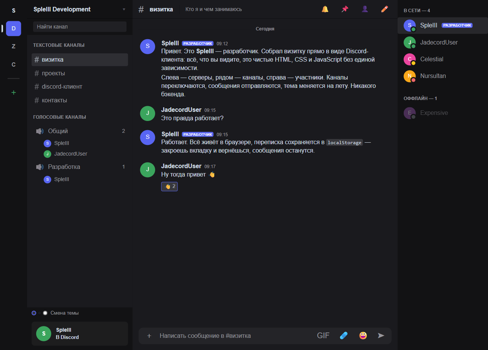

# Compose Client — визитка в стиле Discord

Визитка, собранная как макет приложения Discord: рельс серверов, сайдбар
каналов, лента сообщений, список участников и панель Rich Presence. Всё
написано с нуля — голый HTML, CSS и JavaScript, ни одной зависимости и ни
одного шага сборки.



---

## Что внутри

| Слой | Состав |
|---|---|
| Рельс серверов | иконки серверов, индикатор активного, разделитель, кнопка добавления |
| Сайдбар каналов | заголовок сервера, поиск, текстовые и голосовые каналы, участники в голосовых |
| Область чата | шапка с темой канала, сообщения с группировкой, реакции, эмбеды-карточки, ввод |
| Список участников | онлайн/оффлайн, статусы, бейдж роли, карточка по наведению |
| Rich Presence | панель клиента: активность, статус, переключение в один клик |

---

## Откуда взялись размеры и цвета

Стиль не «похож на Discord» — он **снят с настоящего**. Через инспектор
стилей на `discord.com/app` вытащены реальные значения:

| Параметр | Значение | Откуда |
|---|---|---|
| Рельс серверов | `72px` | `--custom-guild-list-width: calc(40px + 16px * 2)` |
| Аватар сервера | `40px` | `--guildbar-avatar-size` |
| Сайдбар каналов | `280px` | `.sidebar { width: 280px }` |
| Шапка чата | `49px` | `--custom-channel-header-height` |
| Список участников | `240px` | ширина панели участников |
| Blurple | `#5865F2` | `--background-brand` |
| Статус «в сети» | `#3D9E60` | `--status-online` |
| Радиусы | `4 / 8 / 12 / 16 / 24 / 32px` | `--radius-xs` … `--radius-xxl` |
| Шрифт | `gg sans` → Noto Sans → Helvetica | `--font-primary` |

Палитра повторяет все три темы Discord — `theme-dark`, `theme-darker` и
`theme-light` — с настоящими значениями `neutral-*` от `--neutral-1` до
`--neutral-92`. Переключатель внизу слева крутит их по кругу.

Фоны панелей расставлены как в оригинале: рельс и список участников —
`base-lowest`, список каналов и чат — `base-lower`.

---

## Что можно потрогать

| Действие | Как |
|---|---|
| Переключить канал | клик по `#визитка`, `#проекты`, `#discord-клиент`, `#контакты` |
| Отправить сообщение | пишем в поле ввода и жмём `Enter` (сообщения сохраняются в `localStorage`) |
| Сменить тему | кнопка «Смена темы» под списком каналов |
| Сменить активность | шестерёнка в панели Rich Presence — 6 вариантов, включая игровые |
| Сменить статус | клик по самой панели Rich Presence: в сети / неактивен / не беспокоить / невидимый |
| Открыть карточку участника | навести на имя или аватар в списке справа |
| Поискать канал | поле «Найти канал» в сайдбаре |
| Открыть меню сервера | клик по иконке «SpleIII Development» |

Разметка сообщений поддерживает `**жирный**`, `` `код` ``, блоки кода,
ссылки и `@упоминания`.

---

## Структура

```
Discord/
├── index.html            # разметка приложения
├── css/
│   └── discord.css       # токены Discord + компоненты интерфейса
├── js/
│   ├── data.js           # контент визитки: серверы, каналы, участники, сообщения
│   └── app.js            # логика клиента
├── assets/
│   ├── favicon.svg       # иконка вкладки
│   └── preview.png       # превью для README
└── .github/workflows/
    └── deploy.yml        # публикация на GitHub Pages
```

---

## Как запустить

Файл `index.html` работает и просто открытием в браузере. Но чтобы
отправленные сообщения переживали перезагрузку, нужен http-сервер:

```bash
python -m http.server 8000
# открыть http://localhost:8000
```

---

## Где менять контент

Всё наполнение лежит в `js/data.js` — это единственный файл, который нужно
править, чтобы визитка стала вашей:

| Объект | За что отвечает |
|---|---|
| `USERS` | участники: ник, статус, цвет, бейдж роли, «о себе», ссылки |
| `GUILDS` | серверы в рельсе слева |
| `CHANNELS` | каналы: имя, тип, тема, участники голосовых |
| `MESSAGES` | сообщения по каналам, карточки проектов и ссылки |
| `ACTIVITIES` | варианты Rich Presence |
| `THEMES` | темы и их цвета |

Разработчик — `SpleIII`, пользователь, от имени которого пишутся сообщения, —
`JadecordUser`. Обе константы заданы в начале файла: `ME` и `DEVELOPER`.

---

## Лицензия

Учебный проект. Discord — товарный знак Discord Inc.; этот репозиторий не
связан с компанией и не использует её исходный код: разметка, стили и логика
написаны с нуля, а числовые значения дизайна взяты из публичных стилей
приложения как справочные.
